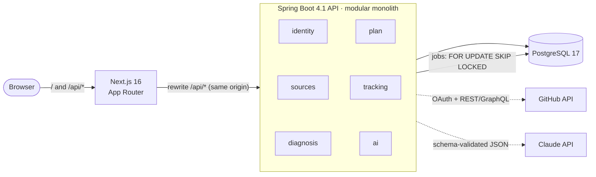

<div align="center">

# Rota Dev

**An evidence-based career plan for software developers.**
Connect your GitHub, LinkedIn and résumé. Get a living, trackable roadmap built from what you have actually shipped.

[](https://github.com/caio-machado-dev/rota-dev/actions/workflows/ci.yml)


[Português](README.md) · **English**

</div>

> [!NOTE]
> **Status: early development.** The technical foundation is done (Phase 0). Product features are being built in public, one small pull request at a time. See the [roadmap](#roadmap).

## Why

Most career-planning tools start with a generic questionnaire and end with a generic plan. Rota Dev starts from **evidence**: the code in your repositories, the experience on your LinkedIn and résumé, and the hours you actually put in each week.

- **Diagnosis with receipts.** Every conclusion cites its source ("3 Spring projects with integration tests", "no repository with CI"). No evidence, no claim: the item is marked *unverified*.
- **A plan that adapts.** Weekly check-ins feed back into the plan, which proposes adjustments that you approve or reject. Every change is versioned with its reason.
- **Learning, not just shipping.** A daily *anti vibe-coding* routine pushes you to read, explain and test the code AI agents write for you, and it counts toward your readiness score.

## Features

| Feature | Description | Status |
|---|---|---|
| Sign in with GitHub | OAuth login, server-side session | 🔜 Phase 1 |
| Source ingestion | GitHub repositories and languages, LinkedIn export (ZIP/PDF), résumé (PDF/DOCX), normalized into a profile snapshot with per-field provenance and confidence | 🔜 Phase 1 |
| Diagnosis | Estimated level per skill axis, skill radar (current vs. target role) and prioritized gaps, all citing evidence | 🗓️ Phase 2 |
| Career plan | Quarterly and weekly roadmap, verifiable milestones (*gates*), an anchor project based on your real history, courses and certifications only when they add value | 🗓️ Phase 2 |
| Tracking | "Today" dashboard, study sessions, weekly tasks, Sunday check-in, readiness index (0–100) | 🗓️ Phase 3 |
| Anti vibe-coding protocol | Daily routine to review AI-generated code: read the full diff, explain it, write a test, take a note | 🗓️ Phase 3 |

## Architecture



- **Modular monolith.** Each top-level package is a module with `domain → application → infrastructure / web` layers. [Spring Modulith](https://spring.io/projects/spring-modulith) verifies module boundaries in a test, so the build fails when one module reaches into another's internals.
- **Same-origin session.** The API owns the OAuth flow and keeps the session server-side; the browser only holds an `HttpOnly` cookie. Next.js proxies `/api/*`, so there is no CORS and no token in `localStorage`.
- **Row-level multi-tenancy.** Every user-owned table carries `user_id`, always taken from the authenticated session; every endpoint gets a cross-tenant isolation test.
- **Durable background jobs.** GitHub ingestion, document parsing and AI calls run as idempotent jobs in a Postgres-backed queue with retries, so they survive restarts.
- **AI behind an interface.** Versioned prompts, JSON output validated against a schema, and token/cost tracking per call. The provider can be swapped without touching use cases.

Every significant choice is recorded as an **[Architecture Decision Record](docs/adr/README.md)** (written in Portuguese), with context, alternatives and trade-offs.

## Tech stack

| Layer | Technologies |
|---|---|
| Backend | Java 25 · Spring Boot 4.1 (Web MVC, Data JPA, Validation, Actuator) · Spring Modulith · Flyway |
| Database | PostgreSQL 17 |
| Frontend | Next.js 16 (App Router) · React 19 · TypeScript · Tailwind CSS 4 · shadcn/ui |
| Testing | JUnit 5 · AssertJ · Testcontainers (real Postgres) · Vitest · Testing Library |
| Infra | Docker (multi-stage, non-root images) · Docker Compose · GitHub Actions |

## Engineering practices

- **Tests against real infrastructure.** Integration tests run against PostgreSQL in Testcontainers, the same version as production, not an in-memory substitute.
- **Schema as code.** Flyway migrations only; Hibernate runs in `validate` mode and never alters the schema.
- **CI on every pull request.** Separate path-filtered workflows for the API and the web app.
- **Git Flow.** `feat/*` → `develop` → `main`, protected branches, Conventional Commits, small reviewable PRs.
- **Sized for a real server.** Containers run with explicit memory limits. The whole stack idles at about 370 MB (measured locally).

## Getting started

Requirements: JDK 25, Docker and Node 24 (with `corepack enable`).

```bash
git clone https://github.com/caio-machado-dev/rota-dev.git
cd rota-dev
docker compose -f infra/compose.yaml up --build
```

- Web: http://localhost:3000
- API health: http://localhost:8080/actuator/health

For hot reload, running the tests and a guided reading order of the code, see the **[development guide](docs/desenvolvimento.md)** (in Portuguese).

## Project structure

```
api/     Spring Boot API. Each package under dev.rotadev.* is a module
web/     Next.js front end
infra/   Docker Compose
docs/    Architecture decision records, domain glossary, development guide
```

## Roadmap

- [x] **Phase 0: foundation.** Monorepo, Docker Compose, CI, ADRs
- [ ] **Phase 1: identity and sources.** GitHub login, repository ingestion, LinkedIn and résumé parsing, profile review
- [ ] **Phase 2: diagnosis and plan.** Goals, AI-generated diagnosis and roadmap with validated output
- [ ] **Phase 3: tracking.** Daily dashboard, sessions, weekly check-in, readiness index, plan adjustments
- [ ] **Deploy.** Production images on GHCR, VPS deployment behind Caddy
- [ ] **Phase 4: SaaS readiness.** Data export and deletion (LGPD), plan limits, observability

## About

I'm **Caio Machado**, a backend engineer from Aracaju, Brazil, working mostly with Python (Django, FastAPI), PostgreSQL and Docker. Rota Dev began as the dashboard I use to plan my own move from junior to mid-level, and to shift my main stack to **Java and Spring**. I'm building it in public as my first large Java project. That's why the code is heavily commented and every decision is written down.

[LinkedIn](https://www.linkedin.com/in/caio-machado-dev/) · [Website](https://caiomachadodev.com.br) · [X](https://x.com/caiodeveloper)

## License

Copyright © 2026 Caio Machado. All rights reserved.
The source code is public for reading and evaluation. No license is granted to use, copy, modify or distribute it.
