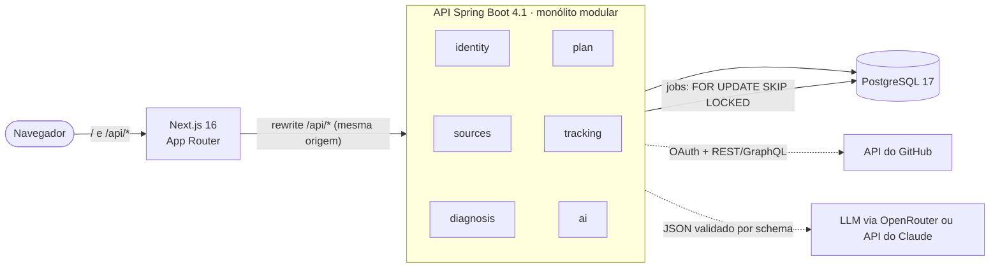

<div align="center">

# Rota Dev

**Um plano de carreira para devs baseado em evidência.**
Conecte seu GitHub, LinkedIn e currículo. Receba um roadmap vivo e acompanhável, construído a partir do que você já entregou de verdade.

[](https://github.com/caio-machado-dev/rota-dev/actions/workflows/ci.yml)


**Português** · [English](README.en.md)

</div>

> [!NOTE]
> **Status: em desenvolvimento inicial.** A fundação técnica está pronta (Fase 0). As funcionalidades do produto estão sendo construídas em público, um pull request pequeno de cada vez. Veja o [roadmap](#roadmap).

## Por quê

A maioria das ferramentas de plano de carreira começa com um questionário genérico e termina com um plano genérico. O Rota Dev começa pela **evidência**: o código nos seus repositórios, a experiência no seu LinkedIn e currículo, e as horas que você realmente dedica a cada semana.

- **Diagnóstico com prova.** Toda conclusão cita a fonte ("3 projetos Spring com testes de integração", "nenhum repositório com CI"). Sem evidência, não há afirmação: o item fica marcado como *não verificado*.
- **Um plano que se ajusta.** O check-in semanal realimenta o plano, que propõe ajustes que você aprova ou recusa. Cada mudança é versionada com o motivo.
- **Aprender, não só entregar.** Uma rotina diária *anti vibe coding* incentiva você a ler, explicar e testar o código que os agentes de IA escrevem, e esse hábito conta no seu índice de prontidão.

## Funcionalidades

| Funcionalidade | Descrição | Status |
|---|---|---|
| Login com GitHub | OAuth, sessão no servidor | 🔜 Fase 1 |
| Ingestão de fontes | Repositórios e linguagens do GitHub, export do LinkedIn (ZIP/PDF), currículo (PDF/DOCX), normalizados num snapshot de perfil com origem e confiança de cada dado | 🔜 Fase 1 |
| Diagnóstico | Nível estimado por eixo, radar de habilidades (atual x cargo-alvo) e lacunas priorizadas, sempre citando evidências | 🗓️ Fase 2 |
| Plano de carreira | Roadmap por trimestre e semana, marcos verificáveis (*portões*), projeto-âncora baseado no seu histórico real, cursos e certificações só quando agregam | 🗓️ Fase 2 |
| Acompanhamento | Painel "Agora", sessões de estudo, tarefas da semana, check-in de domingo, índice de prontidão (0–100) | 🗓️ Fase 3 |
| Protocolo anti vibe coding | Rotina diária para revisar código gerado por IA: ler o diff inteiro, explicar, escrever um teste, registrar uma nota | 🗓️ Fase 3 |

## Arquitetura



- **Monólito modular.** Cada pacote de topo é um módulo com as camadas `domain → application → infrastructure / web`. O [Spring Modulith](https://spring.io/projects/spring-modulith) verifica as fronteiras num teste, e o build quebra se um módulo mexer nas entranhas de outro.
- **Sessão na mesma origem.** A API conduz o OAuth e guarda a sessão no servidor; o navegador só tem um cookie `HttpOnly`. O Next.js repassa `/api/*`, então não há CORS nem token no `localStorage`.
- **Multi-tenant por linha.** Toda tabela com dado de usuário tem `user_id`, sempre vindo da sessão autenticada, e todo endpoint tem um teste de isolamento entre usuários.
- **Jobs duráveis.** Ingestão do GitHub, parsing de documentos e chamadas de IA rodam como jobs idempotentes numa fila no Postgres, com retry, e sobrevivem a reinícios.
- **IA atrás de uma interface.** Prompts versionados, saída em JSON validada por schema e registro de tokens e custo por chamada. Dá para trocar de provedor sem mexer nos casos de uso.

Toda decisão relevante está registrada como **[ADR (Architecture Decision Record)](docs/adr/README.md)**, com contexto, alternativas e trade-offs.

## Stack

| Camada | Tecnologias |
|---|---|
| Backend | Java 25 · Spring Boot 4.1 (Web MVC, Data JPA, Validation, Actuator) · Spring Modulith · Flyway |
| Banco | PostgreSQL 17 |
| Frontend | Next.js 16 (App Router) · React 19 · TypeScript · Tailwind CSS 4 · shadcn/ui |
| Testes | JUnit 5 · AssertJ · Testcontainers (Postgres real) · Vitest · Testing Library |
| Infra | Docker (multi-stage, sem root) · Docker Compose · GitHub Actions |

## Práticas de engenharia

- **Testes contra infraestrutura real.** Os testes de integração rodam contra um PostgreSQL no Testcontainers, na mesma versão da produção, e não contra um banco em memória.
- **Schema como código.** Só migrações Flyway; o Hibernate roda em modo `validate` e nunca altera o schema.
- **CI em todo pull request.** Um workflow único: os jobs da API e do front só rodam se a pasta deles mudou, e o check porteiro `ci-ok` é o único obrigatório para o merge ([ADR 0014](docs/adr/0014-ci-workflow-unico-com-porteiro.md)).
- **Git Flow.** `feat/*` → `develop` → `main`, branches protegidas, Conventional Commits, PRs pequenos e revisáveis.
- **Dimensionado para um servidor real.** Os containers rodam com limite de memória explícito. O stack inteiro em repouso usa cerca de 370 MB (medido localmente).

## Como rodar

Requisitos: JDK 25, Docker e Node 24 (com `corepack enable`).

```bash
git clone https://github.com/caio-machado-dev/rota-dev.git
cd rota-dev
docker compose -f infra/compose.yaml up --build
```

- Web: http://localhost:3000
- Saúde da API: http://localhost:8080/actuator/health

Para hot reload, testes e uma ordem guiada de leitura do código, veja o **[guia de desenvolvimento](docs/desenvolvimento.md)**.

## Estrutura

```
api/     API Spring Boot. Cada pacote em dev.rotadev.* é um módulo
web/     Front-end Next.js
infra/   Docker Compose
docs/    ADRs, glossário do domínio, guia de desenvolvimento
```

## Roadmap

- [x] **Fase 0: fundação.** Monorepo, Docker Compose, CI, ADRs
- [ ] **Fase 1: identidade e fontes.** Login com GitHub, ingestão de repositórios, parsing de LinkedIn e currículo, revisão do perfil
- [ ] **Fase 2: diagnóstico e plano.** Objetivos, diagnóstico e roadmap gerados por IA com saída validada
- [ ] **Fase 3: acompanhamento.** Painel do dia, sessões, check-in semanal, índice de prontidão, reajustes do plano
- [ ] **Deploy.** Imagens de produção no GHCR, deploy na VPS atrás do Caddy
- [ ] **Fase 4: pronto para SaaS.** Exportação e exclusão de dados (LGPD), limites por plano, observabilidade

## Sobre

Sou o **Caio Machado**, engenheiro backend de Aracaju/SE, trabalhando principalmente com Python (Django, FastAPI), PostgreSQL e Docker. O Rota Dev nasceu do painel que eu uso para planejar minha própria evolução de júnior a pleno e para migrar meu eixo principal para **Java e Spring**. Estou construindo em público como meu primeiro projeto Java grande. Por isso o código é bem comentado e cada decisão está documentada.

[LinkedIn](https://www.linkedin.com/in/caio-machado-dev/) · [Site](https://caiomachadodev.com.br) · [X](https://x.com/caiodeveloper)

## Licença

Copyright © 2026 Caio Machado. Todos os direitos reservados.
O código-fonte é público para leitura e avaliação. Nenhuma licença é concedida para usar, copiar, modificar ou distribuir.
